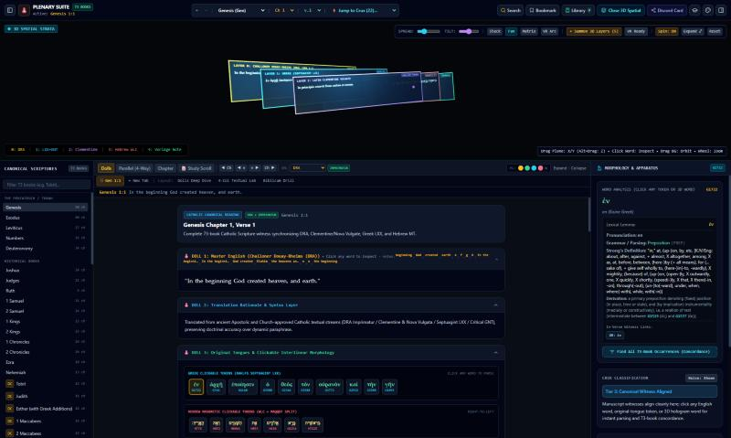
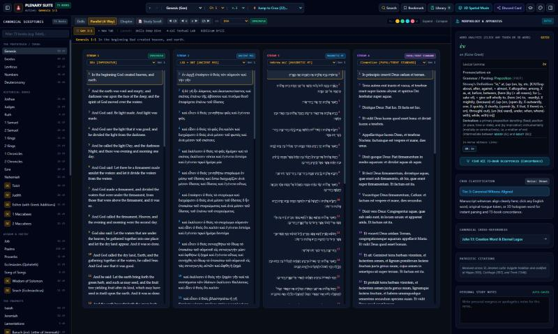
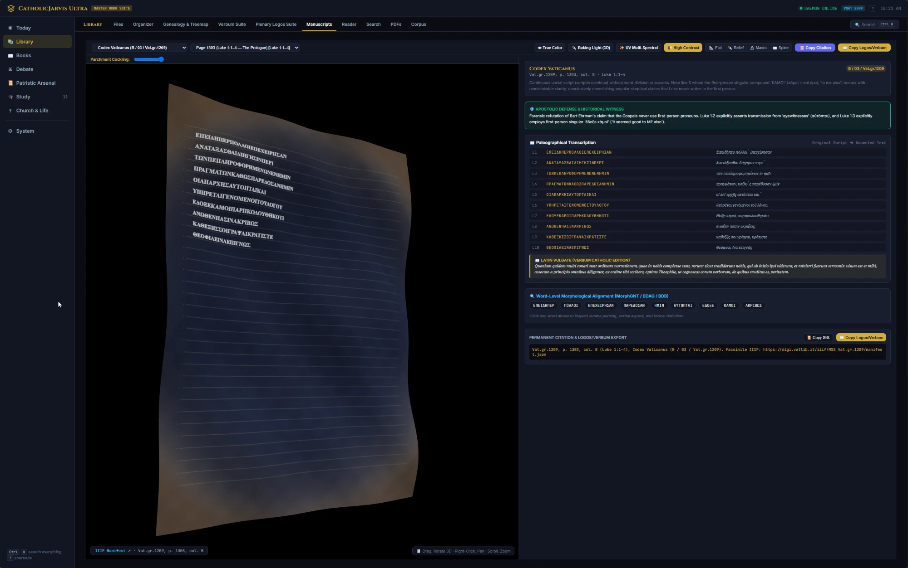

# Biblical Textual Comparison Suite

A self-hosted research workstation for comparative biblical textual criticism and patristics, built
around the **Plenary Logos Suite**: a 73-book (Protestant 66 + 7 Deuterocanonical) Scripture reader
that
synchronizes twelve manuscript/translation witness streams verse-by-verse — Challoner Douay-Rheims,
Clementine and Nova Vulgata, Brenton's Septuagint, the Westminster Leningrad Codex (Hebrew), the
Statistical Restoration Greek New Testament, KJV, ASV, WEB, and more — with clickable interlinear
tokens (Strong's numbers, morphology, lexicon entries), a manuscript-witness apparatus for textual
variants, and a lazy-loaded study-notes layer that pulls from NET Bible, the SBL Study Bible, the
New Oxford Annotated Bible, the NIV Study Bible, and the Ignatius Catholic Study Bible.

The rest of the suite is a FastAPI backend with modules for debate research, a manuscript viewer,
spaced-repetition (Anki-style) review, and a PDF/audio reading studio.

## Screenshots

**3D Spatial Strata** — manuscript witness layers (Douay-Rheims, Septuagint, Clementine Vulgate,
Hebrew Masoretic Text) rendered as draggable, inspectable planes in 3D space:



**Parallel (4-Way)** — up to four of the suite's translations read side by side, each independently
switchable from the full registry:



**Manuscripts** — a teaser of the manuscript-facsimile viewer: IIIF page images (here, Codex
Vaticanus) rendered in 3D with parchment simulation, paleographic transcription, word-level
morphological alignment, and citation export:



## Structure

- `catholic_jarvis_suite/` — the FastAPI app: routes, business logic (`modules/`), frontend
  (`static/`), and tests.
- `web_app/` — the Plenary Logos Suite itself: the build pipeline that extracts and assembles
  Scripture text and study notes from source editions into the suite's data format, plus the
  workstation's own HTML/JS.

## Running it

```bash
cd catholic_jarvis_suite
pip install -r requirements.txt
python app.py --port 8080
```

Open `http://127.0.0.1:8080`.

## On the data

This repo ships the suite's **code**, not the Bible text and commentary it's designed to display.
`web_app/`'s build scripts (`build_notes_shards.py`, `build_nabre_notes.py`, etc.) assemble a
`notes_shards/` directory and a combined `plenary_logos_data.json` at build time from source
editions — NET Bible, NIV Study Bible, NOAB, Ignatius Catholic Study Bible, NABRE, and others —
that are under their respective publishers' copyright, not this project's. Those generated files
are intentionally excluded here. The public-domain and openly-licensed source texts the suite also
uses (Douay-Rheims, KJV, ASV, WEB, Brenton's LXX, the Westminster Leningrad Codex, the Clementine
Vulgate, the Statistical Restoration GNT) are included in `web_app/`, since those are free to share.

See `catholic_jarvis_suite/LICENSE` (MIT, covers this repo's own code) and
`catholic_jarvis_suite/NOTICE` (what's bundled, what's public domain vs. copyrighted, and what that
means for redistribution) for the full breakdown.
