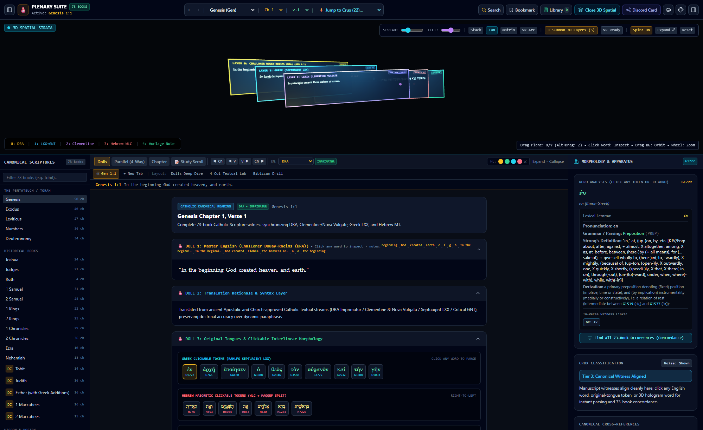
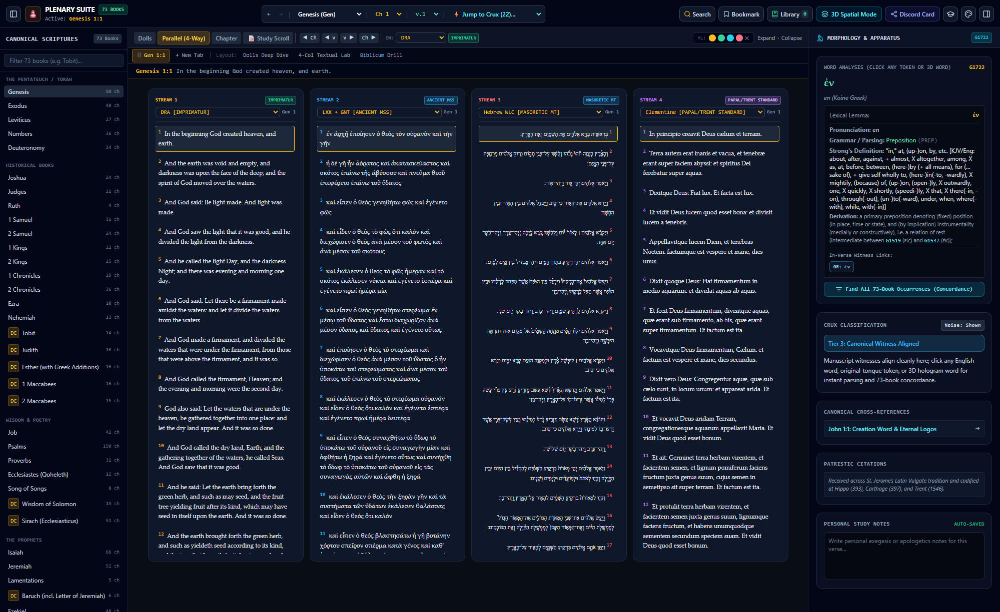
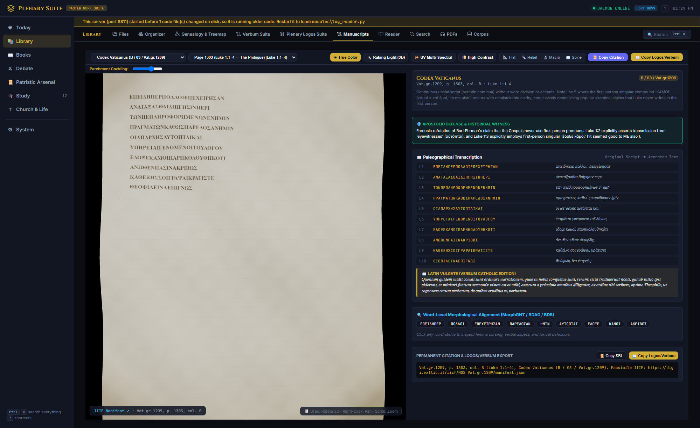

# Plenary Suite

A self-hosted research workstation for comparative biblical textual criticism and patristics, built
around the **Plenary Logos Suite**: a 73-book (Protestant 66 + 7 Deuterocanonical) Scripture reader
that
synchronizes twelve manuscript/translation witness streams verse-by-verse — Challoner Douay-Rheims,
Clementine and Nova Vulgata, Brenton's Septuagint, the Westminster Leningrad Codex (Hebrew), the
Statistical Restoration Greek New Testament, KJV, ASV, WEB, and more — with clickable interlinear
tokens (Strong's numbers, morphology, lexicon entries), a manuscript-witness apparatus for textual
variants, and a lazy-loaded study-notes layer that pulls from NET Bible, the SBL Study Bible, the
New Oxford Annotated Bible, the NIV Study Bible, and the Ignatius Catholic Study Bible.

## Features

### Scripture & manuscripts (self-contained — runs on the bundled/public-domain data)

- **Plenary Logos Suite** — see above: 73-book synchronized reader, 3D witness-stream visualization,
  clickable interlinear morphology, lazy-loaded study notes.
- **Manuscripts** — a curated registry of 16 primary witnesses (the great majuscule codices —
  Vaticanus, Sinaiticus, Alexandrinus, Ephraemi Rescriptus, Bezae, Washingtonianus, Claromontanus;
  key papyri — P52, P45, P46, P66, P75; plus the Bryennios Codex, Oxyrhynchus 840, the Great Isaiah
  Scroll, and 4QMMT), each rendered in 3D from its real IIIF facsimile endpoint with parchment-curve
  simulation, simulated raking-light/UV-multispectral display modes, line-by-line paleographic
  transcription, word-level morphological alignment (MorphGNT / BDAG / BDB), and one-click SBL
  citation export.
- **Verbum Suite** — a from-scratch synoptic exegetical workspace in the spirit of Logos/Verbum
  Bible software: synchronized Greek NT (NA28/SBLGNT/MorphGNT), Latin Vulgate, English, and Hebrew
  MT panes; patristic catena commentary (Aquinas, Chrysostom, Cornelius à Lapide, Haydock); a
  multi-tier morphological interlinear ribbon; and a side-by-side translation-difference comparison
  engine.

### Research tools (point these at your own folders — see Configuration below)

- **Organizer & Corpus** — indexes an entire personal document/notes/code tree, classifies every
  file (subject matter vs. infrastructure vs. provenance), and runs a single SQLite FTS5 full-text
  index across years of chat logs and notes at once, so one query surfaces both the conversation
  where an idea came up and the file it ended up in.
- **Genealogy & Treemap** — a toggle-sortable treemap (by date modified/created/accessed, size, or
  category) of every note and file ever written, plus a directed "what file caused which file"
  provenance graph built from citations, wiki-links, and detected parent → child synthesis.
- **Debate** — reconstructs full argument threads out of pasted chat logs: merges a thread that was
  pasted again later as it grew (via message fingerprinting), splits each reply into individual
  argument points, and tracks which points were actually posted in the live exchange versus drafted
  and never sent.
- **Study** — an in-browser SM-2 spaced-repetition engine (Anki-compatible TSV export) for
  vocabulary and argument flashcards, including objection drills generated automatically from
  harvested debate threads.

### Reading studio

- **PDF/audio reading studio** — neural text-to-speech read-aloud with word-level teleprompter
  highlighting and chunked auto-scroll, plus a one-key clip-to-corkboard capture that feeds
  straight into the spaced-repetition queue.

## Screenshots

**3D Spatial Strata** — manuscript witness layers (Douay-Rheims, Septuagint, Clementine Vulgate,
Hebrew Masoretic Text) rendered as draggable, inspectable planes in 3D space:



**Parallel (4-Way)** — up to four of the suite's translations read side by side, each independently
switchable from the full registry:



**Manuscripts** — a teaser of the manuscript-facsimile viewer: IIIF page images (here, Codex
Vaticanus) rendered in 3D with parchment simulation, paleographic transcription, word-level
morphological alignment, and citation export:



## Structure

- `catholic_jarvis_suite/` — the FastAPI app: routes, business logic (`modules/`), frontend
  (`static/`), and tests.
- `web_app/` — the Plenary Logos Suite itself: the build pipeline that extracts and assembles
  Scripture text and study notes from source editions into the suite's data format, plus the
  workstation's own HTML/JS.

## Running it

```bash
cd catholic_jarvis_suite
pip install -r requirements.txt
python app.py --port 8080
```

Open `http://127.0.0.1:8080`.

## Configuration

The Scripture/manuscript features above need nothing configured. The research tools (Organizer,
Corpus, Genealogy & Treemap, Debate, Study, Reader, Today) read from a personal document tree, and
every path they use is a setting, not something baked into the code — `modules/paths_config.py` is
the single place they're all defined, so pointing the suite at your own folders means setting a few
values there instead of hunting through the module files.

Two ways to override a path, either works:

- **Environment variable** — `JARVIS_<KEY>`, e.g. `JARVIS_HOME=C:\Users\you` or
  `JARVIS_MEXICO_STUDY=D:\my-notes\some-project`.
- **`catholic_jarvis_suite/data/jarvis_paths.json`** — a flat JSON object, e.g.
  `{"home": "C:\\Users\\you", "pdfs_dir": "D:\\Books"}`.

See `DEFAULTS` in `modules/paths_config.py` for the full key list (`home`, `dissertation_project`,
`mexico_study`, `scholar_decade_plan`, `aa1_vault`, `ag_history_backup`, `pdfs_dir`, `downloads`,
`ocr_index`, `research_imports_text`, `claude_projects`, `gemini_antigravity_brain`) and what each
one feeds. `Files` and `Genealogy & Treemap` have their own override file,
`data/files_roots.json` (a list of `[path, label]` pairs), since they already supported this before
the rest of the suite did.

## On the data

This repo ships the suite's **code**, not the Bible text and commentary it's designed to display.
`web_app/`'s build scripts (`build_notes_shards.py`, `build_nabre_notes.py`, etc.) assemble a
`notes_shards/` directory and a combined `plenary_logos_data.json` at build time from source
editions — NET Bible, NIV Study Bible, NOAB, Ignatius Catholic Study Bible, NABRE, and others —
that are under their respective publishers' copyright, not this project's. Those generated files
are intentionally excluded here. The public-domain and openly-licensed source texts the suite also
uses (Douay-Rheims, KJV, ASV, WEB, Brenton's LXX, the Westminster Leningrad Codex, the Clementine
Vulgate, the Statistical Restoration GNT) are included in `web_app/`, since those are free to share.

See `catholic_jarvis_suite/LICENSE` (MIT, covers this repo's own code) and
`catholic_jarvis_suite/NOTICE` (what's bundled, what's public domain vs. copyrighted, and what that
means for redistribution) for the full breakdown.
