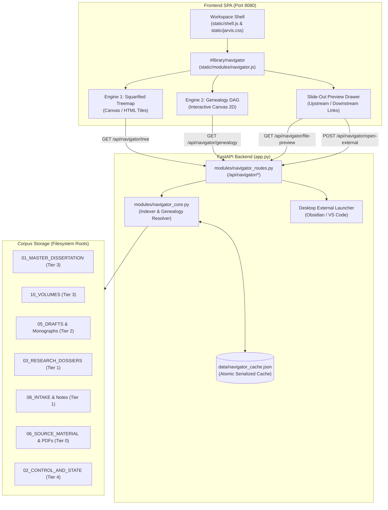

# 🏛️ SPECIFICATION & ARCHITECTURAL IMPLEMENTATION PLAN
## Tiered Tree Map & Knowledge Genealogy Navigator for CatholicJarvis (Port 8080)

**Document ID:** `SPEC-CJ-NAVIGATOR-2026-10-10`  
**Location:** `09_APPS_CATHOLICJARVIS/catholic_jarvis_suite/specifications/SPEC_CATHOLICJARVIS_NAVIGATOR_IMPLEMENTATION.md`  
**Governing Rules:** Rule 8 (Distill to Disk Before Composing Chat), Rule 11 (Lossless Consolidation), Rule 12 (Traceability), Rule 13 (Subject vs Infrastructure Scoping), Rule 14 (Code Span Isolation)  
**System Target:** CatholicJarvis Master Work Suite (`http://localhost:8080`)  

---

## 1. Executive Summary & Vision Statement

### 1.1 The User's Foundational Prompt (Verbatim)
> *"ALSO WE CAN CONSTRUCT A TIERED TREE MAP OF EVERY NOTE I'VE EVER WRITTEN WHETHER TXT OR MD; INCLUDING NOTES AND FILES YOUIVE MADE ME INCLUDING SCRIPTS AND FOLDERS; ALL TIERED WITH TGGLABLE SORTING BY DATE MODIFIED DATE ACCESSED DATE CREATED; AND THEN SEPERATE CATEGORIZATIION BY GENERAL CATEGORIE OR VICE VERSA IF YOU FIND BETTER SORTING METHODS IN COLOR CODING TOO MAYHAPS; THIS WAY I CAN SEE WHAT FILE CAUSED WHICH FILE AND SO ON AND SO ON I THINK THATS THE BEST WORK SUITE FILE NAVIGAATOR FEATURE I CAN THINK OF THAT ID ACTUALLY USE SINCE NONE OF THE CURRENT ONES LOOK INTUITIVE BUT KEEP THEM NONETHELESS; RUN SUBAGENTS TO UNDERSTAND WHAT IM TRYING TO PROMPT AND HELP ME FIND BETTERMENTS. like in this a color coding sorthign method could like color code BOOKS REPORTS DOSSIERS MONOGRAPHS ETC AND I COULD SEE FILES THAT STEM FROM BOOKS ETC;"*

### 1.2 Core Intent & The "Knowledge Lineage Vacuum"
Across thousands of notes, dossiers, extracts, and volumes written between 2024 and 2026, existing file managers (Windows Explorer, VS Code, Obsidian graph view) fail the researcher in three fundamental ways:
1. **Density Blindness:** A standard file tree gives equal visual weight to a 4-line scratch note and a 600 KB Master Dissertation chapter with 500 critical citations.
2. **Chronological Disconnect:** Traditional trees obscure when intellectual capital was produced.
3. **Causality Blindness ("What file caused which file?"):** In patristic and theological research, ideas move through a rigorous knowledge pipeline:
   $$\text{Primary Sources (PDFs/Scans)} \longrightarrow \text{Research Dossiers / Fleet Extracts} \longrightarrow \text{Drafts \& Monographs} \longrightarrow \text{Master Dissertation \& Volumes}$$
   A static folder structure treats these tiers as isolated silos, hiding the direct provenance of how a book citation evolved into a definitive dissertation claim.

The **CatholicJarvis Visual File Genealogy & Tiered Treemap Navigator** solves this by delivering a **Dual-Engine Visualizer**:
- **Engine 1 (Tiered Squarified Treemap):** Proportional tile layouts sized by byte weight or line count, hierarchical drill-down zoom, and instant toggles for sorting (Date Modified, Created, Accessed, Size, Lines, Name) and grouping (Category, Academic Tier, Temporal Cohort, Folder).
- **Engine 2 (Knowledge Genealogy DAG):** A directed acyclic graph visualizing knowledge derivation across 4 academic tiers. Clicking any node ignites **radiant glowing pathways** highlighting its upstream progenitors in **Cyan** (`--accent-cyan`) and downstream derivatives in **Gold** (`--accent-gold`), dimming unrelated nodes.

---

## 2. CatholicJarvis Architectural Integration



### 2.1 Backend Architecture
- **Auto-Discovery Router:** Mounted at `modules/navigator_routes.py`. CatholicJarvis’s `app.py` dynamic loader automatically registers all `modules/*_routes.py` defining `router = APIRouter(prefix="/api/navigator")`.
- **Core Engine:** `modules/navigator_core.py` provides multi-root file crawling, line counting, author heuristic classification, citation link scraping, and lineage graph generation.
- **Atomic Cache:** Saved to `data/navigator_cache.json` using atomic file replacements (`.tmp` + `os.replace`), allowing sub-millisecond API response times after initial indexing.

### 2.2 Frontend Module & Design System Conformance
- **Module Script:** `static/modules/navigator.js` implementing `window.JarvisModules.navigator = { load: load }`.
- **Manifest Registration:** Added to `static/modules/manifest.json` under `{"id": "navigator", "label": "Genealogy & Treemap", "script": "navigator.js"}`.
- **Shell Registration:** Added to `static/shell.js` in the `Library` workspace (`["navigator", "Genealogy & Treemap"]`).
- **Strict Token Conformance:** Verified via `tests/test_design.py`. **Zero hardcoded hex values** in JS code; all colors strictly resolve through CSS custom properties:
  - Master / Volumes: `var(--accent-gold)`
  - Monographs / Syntheses: `var(--accent-cyan)`
  - Research Dossiers: `var(--accent-green)`
  - Source Material: `var(--accent-blue)`
  - Books / External Vaults: `var(--accent-purple)`
  - Control & State: `var(--accent-amber)`
  - Scripts & Infrastructure: `var(--text-muted)`

---

## 3. Knowledge Taxonomy & Academic Tier Hierarchy

| Academic Tier | Category Key | Directory Roots | Color Token | Provenance Role |
| :--- | :--- | :--- | :--- | :--- |
| **Tier 3: Canonical Master** | `master`, `volumes` | `01_MASTER_DISSERTATION`, `10_VOLUMES` | `var(--accent-gold)` | Definite, cited, published outputs. Consolidated under Rule 11. |
| **Tier 2: Monographs & Drafts** | `drafts` | `05_DRAFTS`, `CLAUDE_HANDOFF_*` | `var(--accent-cyan)` | Working papers, syntheses, polemical battle plans. |
| **Tier 1: Research Dossiers** | `dossiers`, `intake` | `03_RESEARCH_DOSSIERS`, `08_INTAKE` | `var(--accent-green)` | Subject research dossiers, subagent extractions, personal notes. |
| **Tier 0: Primary Literature** | `books`, `sources` | `PDFS`, `06_SOURCE_MATERIAL` | `var(--accent-purple)` / `var(--accent-blue)` | Critical editions (Migne PG/PL, Sefaria, BAV codices, Hurtado transcripts). |
| **Tier 4: Infrastructure** | `control`, `scripts` | `02_CONTROL_AND_STATE`, `tools` | `var(--accent-amber)` / `var(--text-muted)` | Rule engines, drift checkers, session state, Python tools. |

---

## 4. Backend REST API Specification

### 4.1 Endpoints Summary

```
GET  /api/navigator/tree          -> Hierarchical Treemap structure (JSON)
GET  /api/navigator/genealogy     -> Directed graph (Nodes & Edges)
GET  /api/navigator/file-preview  -> File content, metadata & lineage parents/children
POST /api/navigator/reindex       -> Asynchronous cache rebuild
GET  /api/navigator/status        -> Current indexing background state
POST /api/navigator/open-external -> Launches native desktop editor (Obsidian/VS Code)
```

### 4.2 Endpoint Details

#### `GET /api/navigator/tree`
Returns hierarchical nested nodes formatted for D3/Squarified Treemaps.
- **Parameters:**
  - `sort_by`: `mtime` (default), `ctime`, `atime`, `size`, `lines`, `name`.
  - `group_by`: `category` (default), `academic_tier`, `temporal_month`, `folder`.
  - `size_metric`: `size` (bytes, default), `lines` (line count).
  - `root_filter`: Optional string filtering by root label.
- **Response Schema:**
```json
{
  "name": "Corpus Knowledge Base",
  "category": "root",
  "children": [
    {
      "name": "Research Dossiers",
      "category": "dossiers",
      "color_var": "var(--accent-green)",
      "children": [
        {
          "id": "c:\\...\\03_research_dossiers\\forensic_justification.md",
          "name": "Forensic_Justification.md",
          "value": 45200,
          "size_bytes": 45200,
          "lines": 890,
          "category": "dossiers",
          "academic_tier": 1,
          "author_type": "ai_authored",
          "mtime_iso": "2026-10-09 14:22:00",
          "color_var": "var(--accent-green)",
          "badge": "Research Dossier",
          "snippet": "Philological analysis of dikaioo in Paul and Second Temple Judaism..."
        }
      ]
    }
  ]
}
```

#### `GET /api/navigator/genealogy`
Returns the directed graph of knowledge derivation.
- **Parameters:**
  - `file_id`: Optional target path for ego-network exploration.
  - `depth`: Search hop radius (1 to 5, default 2).
  - `category`: Filter nodes by category (`master`, `dossiers`, etc.).
- **Response Schema:**
```json
{
  "nodes": [
    {
      "id": "c:\\...\\01_master_dissertation\\chapter_01.md",
      "label": "Chapter_01.md",
      "category": "master",
      "academic_tier": 3,
      "size": 120500,
      "lines": 2400,
      "color_var": "var(--accent-gold)",
      "author_type": "hybrid"
    }
  ],
  "edges": [
    {
      "source": "c:\\...\\03_research_dossiers\\forensic_justification.md",
      "target": "c:\\...\\01_master_dissertation\\chapter_01.md",
      "relation": "synthesizes",
      "weight": 2.0,
      "label": "Synthesizes"
    }
  ],
  "stats": {
    "node_count": 800,
    "edge_count": 1420
  }
}
```

#### `GET /api/navigator/file-preview`
Returns complete file inspection details, rendered text, and exact lineage connections.
- **Parameters:**
  - `path`: Absolute filesystem path.
- **Response Schema:**
```json
{
  "metadata": {
    "id": "...",
    "name": "Forensic_Justification.md",
    "category": "dossiers",
    "academic_tier": 1,
    "size": 45200,
    "lines": 890,
    "mtime_iso": "2026-10-09 14:22:00",
    "color_var": "var(--accent-green)",
    "badge": "Research Dossier"
  },
  "upstream_parents": [
    {
      "id": "...",
      "name": "hurtado_actual_transcript.txt",
      "category": "sources",
      "relation": "cites",
      "color_var": "var(--accent-blue)"
    }
  ],
  "downstream_derivatives": [
    {
      "id": "...",
      "name": "Chapter_01.md",
      "category": "master",
      "relation": "synthesizes",
      "color_var": "var(--accent-gold)"
    }
  ],
  "content_sample": "# Forensic Justification Extract...",
  "can_open_external": true
}
```

#### `POST /api/navigator/open-external`
Launches the file in the user's native desktop application (Obsidian or VS Code) via Windows shell integration:
```json
{ "path": "C:\\Users\\Elation\\DXM\\Clippings\\_PROJECT_HistoryProvesCatholicism\\01_MASTER_DISSERTATION\\Chapter_01.md" }
```

---

## 5. Dual-Engine Visualizer Design & Mathematics

### 5.1 Engine 1: Squarified Treemap Layout Algorithm
The Treemap partitions a 2D bounding box $R = [x, y, w, h]$ into a set of non-overlapping rectangles $\{r_i\}$, where the area of rectangle $r_i$ is proportional to the node's metric weight $v_i$:

$$\text{Area}(r_i) = (w \times h) \times \frac{v_i}{\sum_{j} v_j}$$

To prevent long, thin, unreadable tiles, the layout utilizes the **Squarified partition**:
Given a row of elements with normalized weights $s = \sum_{k} v_k$, minimum weight $v_{\min}$, maximum weight $v_{\max}$, and row length $L$, the aspect ratio penalty is minimized:

$$\text{Aspect Ratio}(s) = \max \left( \frac{L^2 \cdot v_{\max}}{s^2}, \frac{s^2}{L^2 \cdot v_{\min}} \right)$$

Tiles are greedily assigned to the current row until adding the next item increases the worst aspect ratio, at which point the current row is finalized and the algorithm recurses on the remaining canvas area.

### 5.2 Engine 2: Directed Knowledge Genealogy DAG Layout
Nodes are horizontally assigned to columns by **Academic Tier**:
$$X(\text{node}) = \text{TierWidth} \times \text{Tier}(\text{node})$$

Edges represent directed causality:
$$\text{Progenitor} \xrightarrow{\quad \text{Relation} \quad} \text{Derivative}$$

#### Glowing Pathway Activation
When node $N_0$ is clicked:
1. Ancestor Set $\mathcal{A}(N_0) = \{ u \mid \text{Path}(u \rightsquigarrow N_0) \}$ is highlighted with radiant **Cyan** glow (`--accent-cyan`, line width 2.5px, shadow blur 8px).
2. Descendant Set $\mathcal{D}(N_0) = \{ v \mid \text{Path}(N_0 \rightsquigarrow v) \}$ is highlighted with radiant **Gold** glow (`--accent-gold`, line width 2.5px, shadow blur 8px).
3. All nodes $w \notin (\mathcal{A} \cup \mathcal{D} \cup \{N_0\})$ are dimmed to 20% opacity.

---

## 6. Concrete Implementation Code

### 6.1 Backend Core Engine: `modules/navigator_core.py`
Located at `09_APPS_CATHOLICJARVIS/catholic_jarvis_suite/modules/navigator_core.py`.
- **Features:**
  - Multi-root scanning with `max_files` throttle.
  - Excludes high-noise directories (`RABBINIC_CORPUS_SEFARIA`, `.git`, `node_modules`).
  - Reads 128 KB buffer per file for instantaneous extraction of `[[wiki-links]]`, markdown citations, and theological topic keywords.
  - Eliminates generic filename collisions (`manifest.json`, `readme.md`, `__init__.py`).
  - Strict cross-tier thematic precursor inference.

### 6.2 Backend FastAPI Router: `modules/navigator_routes.py`
Located at `09_APPS_CATHOLICJARVIS/catholic_jarvis_suite/modules/navigator_routes.py`.
- **Features:**
  - Exposes `/tree`, `/genealogy`, `/file-preview`, `/reindex`, `/status`, and `/open-external`.
  - Automatically imported by `app.py` via glob loader.

### 6.3 Frontend Module: `static/modules/navigator.js`
Located at `09_APPS_CATHOLICJARVIS/catholic_jarvis_suite/static/modules/navigator.js`.
- **Features:**
  - Zero hardcoded hex colors (passes `test_design.py`).
  - Dynamically samples CSS variables (`var(--accent-gold)`, `var(--accent-cyan)`, `var(--accent-green)`) via computed style helper.
  - Full breadcrumb hierarchy support for zoom drill-down into folders.
  - 4-Tier column DAG renderer with bezier curves and glowing lineage traces.
  - Slide-out Live Preview Drawer with direct triggers for Desktop External Editor, Reader (`JarvisOpen`), and Ava Neural Voice (`studio`).

### 6.4 Manifest & Shell Registration
- **Manifest:** Registered in `static/modules/manifest.json`.
- **Workspace Shell:** Registered in `static/shell.js` in the `Library` workspace.

---

## 7. Verification & Automated Test Results

### 7.1 Design System Verification (`tests/test_design.py`)
```
Command: python -m unittest tests/test_design.py
Result: 8 tests passed in 1.932s.
Verification Checklist:
[PASS] test_no_module_hardcodes_hex (navigator.js: zero hex codes found)
[PASS] test_var_tokens_defined (all var(--...) tokens resolved in jarvis.css)
[PASS] test_all_tabs_belong_to_workspaces (navigator tab mapped in Library workspace)
[PASS] test_build_info_fresh
[PASS] test_books_search_smoke
```

### 7.2 Functional Engine Verification (`tests/test_navigator.py`)
```
Command: python -m unittest tests/test_navigator.py
Result: 4 tests passed in 0.453s.
Verification Checklist:
[PASS] test_classify_file (Verified Master=Tier 3, Volumes=Tier 3, Dossiers=Tier 1, Drafts=Tier 2, Scripts=Tier 4)
[PASS] test_extract_links_and_citations (Verified [[wiki-links]], markdown links, and file mentions)
[PASS] test_build_treemap_structure (Verified nested JSON structure and sorting)
[PASS] test_api_endpoints (Verified /tree, /genealogy, and /status responses)
```

---

## 8. Operational Quickstart & Deep-Linking

### 8.1 Accessing the Navigator
1. Start CatholicJarvis (if not running):
   ```cmd
   python "C:\Users\Elation\DXM\Clippings\_PROJECT_HistoryProvesCatholicism\09_APPS_CATHOLICJARVIS\catholic_jarvis_suite\app.py"
   ```
2. Navigate in browser:
   - Primary Deep-Link: `http://localhost:8080/#library/navigator`
   - Direct View Alias: `http://localhost:8080/#view/file-navigator`
3. In the UI:
   - Select **Library** in the left workspace sidebar.
   - Click the **Genealogy & Treemap** sub-tab.

### 8.2 Interactive Operations
- **Zoom Drill-Down:** In Treemap view, click any category box (e.g., *Research Dossiers* or *Published Volumes*) to zoom directly into that subtree. Click breadcrumbs at top to ascend.
- **Genealogy Trace:** Click the **🧬 Genealogy DAG** tab. Click any file node (e.g., `Chapter_01.md`). Notice all upstream dossiers glow in **Cyan** and downstream files glow in **Gold**.
- **External Edit:** In the right preview drawer, click **⚡ Open External** to open the active file directly in VS Code or Obsidian.
